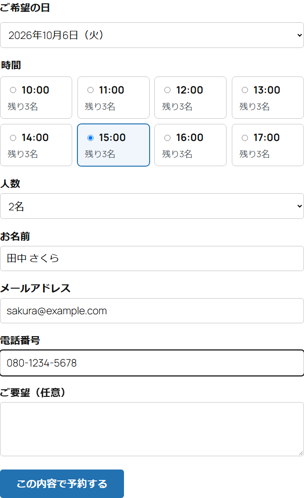
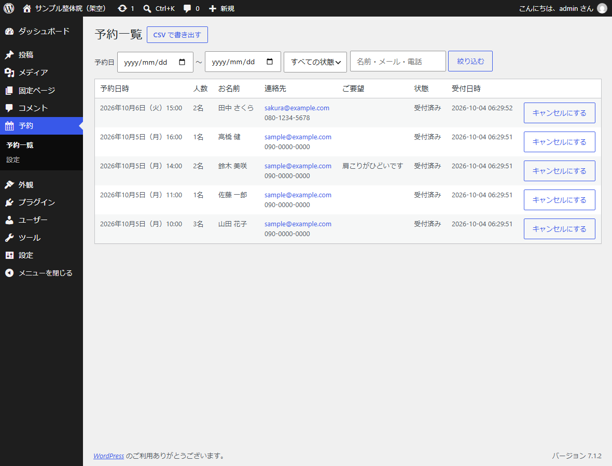

# 予約受付プラグイン（simple-reservation）

WordPressに、日付と時間枠を選んで申し込む予約フォームを付けるプラグインです。PHPで作りました。
整体院・教室・相談会のように「1枠の定員が決まっている予約」を想定しています。予約は管理画面で一覧にでき、キャンセルやCSVでの書き出しもできます。

クライアント案件ではなく、WordPressのプラグイン開発の作り方と品質を見ていただくためのサンプルです。画面のサイト名・お名前はすべて架空です。



## できること

- 固定ページなどに `[simple_reservation]` と書くと、予約フォームが出る
- 日付を選ぶと、その日の時間枠と残りの人数が出る。定員に達した枠は「満席」で選べない
- 予約を受け付けると、お客さまに確認メール、お店に通知メールを送る
- 管理画面で、予約日・状態・名前やメールで絞り込んで一覧にする。キャンセルすると、その枠の空きが戻る
- CSVで書き出す（Excelでそのまま開けるようBOM付き）
- 設定画面で、受け付ける曜日・時間・1枠の長さと定員・何日先まで・何時間前で締め切るか・休業日を変えられる



## 作りで気をつけたこと

一番気をつけたのは、**同じ枠に同時に申し込まれても定員を超えない**ことです。「空きを数える」と「登録する」の間に別の申し込みが入ると、定員3の枠に4人入ってしまいます。枠ごとにMySQLの名前付きロック（`GET_LOCK`）をかけて、1件ずつ処理しています。PHPのプロセスを10個同時に動かすテストで、3件だけが入ることを確かめました。ロックを外すと4件入ってテストが落ちることも確認しています。

WordPressの作法は次のように守っています。

- フォームと管理画面の操作にはnonce（合言葉）を付け、管理画面の操作は `manage_options` の権限がある人だけにしています
- SQLはすべて `$wpdb->prepare` を通し、画面に出す値は `esc_html` などでエスケープしています
- 送信は `admin-post.php` で受けて元のページに戻すので、再読み込みで二重に予約されません
- 入力ミスのときは、項目ごとにエラーを出し、入れた内容は消しません。電話番号は全角で入れても半角にそろえます
- CSVに書き出すとき、`=` `+` `-` `@` で始まる値には `'` を付けて、Excelで数式として動かないようにしています（CSVインジェクション対策）
- 人には見えない入力欄で、機械的な迷惑投稿をはじきます
- プラグインを削除すると、予約のテーブルと設定も消します（個人情報を残さないため）

予約枠の計算（営業日・閉店時刻をまたぐ枠・締め切り・休業日）と入力チェックはWordPressから切り離したクラスにして、PHPUnitでテストしています。

## 動作環境

WordPress 6.5以降、PHP 8.1以降、MySQL 8.0（`GET_LOCK` を使うためMySQLかMariaDB）。WordPress 7.1.2・PHP 8.3・MySQL 8.0で確認しました。

## 使い方

1. `simple-reservation` フォルダを `wp-content/plugins/` に置き、管理画面の「プラグイン」で有効にする
2.「予約」→「設定」で、曜日・時間・定員などを決める
3.固定ページを作り、本文に `[simple_reservation]` と書いて公開する

## テスト

```bash
composer install
vendor/bin/phpunit          # 予約枠の計算と入力チェック（13件）
npm install
npx playwright test         # 手元の WordPress を画面で動かすテスト（7件）
```

E2Eテストは、手元に立てたWordPress（PHPの組み込みサーバー＋MySQL）に対して動かします。開発用のファイルは `dev/` にあります。

- `dev/router.php` … PHPの組み込みサーバーでWordPressのパーマリンクを動かすためのもの
- `dev/dev-mail-log.php` … メールを送らずにファイルへ書き出すmu-plugin（受付メールの中身をテストで確かめるため）

WordPressの場所とPHPの場所は、環境変数 `WP_DEV` と `PHP_BIN` で指定します。

確かめていることは次のとおりです。

- 予約すると受付の表示が出て、お客さまとお店にメールが届く（全角の電話番号は半角になる）
- 入力ミスの表示と、入れた内容が残ること
- 残りより多い人数は断り、埋まった枠は選べなくなること
- nonceのない送信と、ログインしていない人の管理操作を断ること
- 10件同時に申し込んでも、定員3の枠には3件しか入らないこと
- 管理画面での一覧・CSV（BOMと数式対策）・キャンセルで空きが戻ること

## 構成

```
simple-reservation/
  simple-reservation.php  プラグインの入口（有効化でテーブルを作る）
  uninstall.php           削除のときの後片付け
  src/Settings.php        設定（範囲外の値は丸める）
  src/SlotCalendar.php    予約枠の計算（WordPress に依存しない）
  src/Validator.php       入力チェック（WordPress に依存しない）
  src/Repository.php      予約の読み書き（ロックで定員を守る）
  src/Front.php           予約フォームと送信の受け付け
  src/Admin.php           管理画面（一覧・キャンセル・CSV・設定）
  src/Plugin.php          設定の読み出し・メール
  assets/                 フォームの CSS と JavaScript
tests/                    PHPUnit
e2e/                      Playwright
dev/                      開発用（組み込みサーバーのルーター、メールの書き出し）
```

## 使った技術

PHP 8.3、WordPress 7.1（Settings API・admin-post・nonce・$wpdb・dbDelta）、MySQL 8.0、PHPUnit 11、Playwright

## ライセンス

GPL-2.0-or-later
